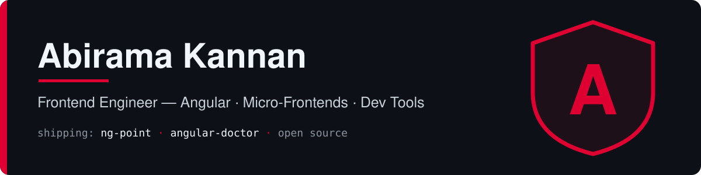

<!-- GitHub profile README - abiramcodes/abiramcodes. Commit README.md + assets/ together. -->

<p align="center">
  
</p>

<p align="center">
  
</p>

<p align="center">
  I build performant UIs, ship Angular dev tools to npm, contribute to open source, and care about clean, maintainable code.
</p>

<p align="center">
  <a href="https://www.abikb.xyz/"></a>
  <a href="https://www.linkedin.com/in/abirama-kannan-baskar"></a>
  <a href="https://x.com/abiramcodes"></a>
  <a href="mailto:akbhere20@gmail.com"></a>
</p>

<p align="center">
  <a href="https://github.com/abiramcodes/ng-point"></a>
  <a href="https://github.com/abiramcodes/ng-point/stargazers"></a>
  <a href="https://github.com/abiramcodes/angular-doctor"></a>
  <a href="https://github.com/abiramcodes/angular-doctor/stargazers"></a>
</p>

## About

- Currently shipping **[ng-point](https://github.com/abiramcodes/ng-point)** + **[angular-doctor](https://github.com/abiramcodes/angular-doctor)** - details below
- Exploring modern Angular (signals, zoneless, standalone, control flow) + AI-assisted workflows
- Frontend Engineer working in Angular / React / Astro
- Spoke at **ng-India Chennai** on Dynamic Components & Forms

## Shipping

### [ng-point](https://github.com/abiramcodes/ng-point) - One Alt+Click. Your agent is already on it.

Alt+Click any element in your running Angular app → an **LLM-ready context block on your clipboard**, at a fraction of the tokens of a screenshot. Paste it straight into Claude Code, Cursor, Copilot, or any coding agent. **Dev-mode only. Redacted at capture. Never in production bundles.**

```text
Component: SubmitButtonComponent
File: src/app/orders/submit-button.component.ts:19
Template: src/app/orders/submit-button.component.ts:16
Element: <button class="btn btn-primary">Approve selected</button>
Parent: OrdersPage (src/app/pages/orders-page.ts:110)
Instruction: disable this while orders are loading
```

**Setup - install + one provider, that's it:**

```bash
npm i -D @abiramcodes/ng-point        # pnpm: pnpm add -D @abiramcodes/ng-point
npx skills add abiramcodes/ng-point   # optional: teach your agent to drive it
```

```ts
// app.config.ts
import { provideNgPoint } from '@abiramcodes/ng-point';

export const appConfig: ApplicationConfig = {
  providers: [provideRouter(routes), provideNgPoint()],
};
```

<kbd>Alt</kbd>+<kbd>Click</kbd> pick · <kbd>Alt</kbd>+<kbd>Shift</kbd>+<kbd>Click</kbd> add (up to 5) · <kbd>Alt</kbd>+<kbd>↑</kbd>/<kbd>↓</kbd> re-target · <kbd>Enter</kbd> copy · <kbd>Esc</kbd> close _(macOS: <kbd>Option ⌥</kbd> = <kbd>Alt</kbd>)_

JWTs, API keys & typed values redacted before copy - mark anything off-limits with `ngPointIgnore` · Angular **21–22** (exact `Template:` line on 22.1.4+) · zone or zoneless · micro-frontends supported · no build plugin

[Docs & live demo](https://abiramcodes.github.io/ng-point/) · [npm](https://www.npmjs.com/package/@abiramcodes/ng-point) · [GitHub](https://github.com/abiramcodes/ng-point) · [Agent skill](https://skills.sh/abiramcodes/ng-point)

### [angular-doctor](https://github.com/abiramcodes/angular-doctor)

Deterministic health scanner for Angular codebases and coding agents. 0–100 score, categorized diagnostics, agent-ready report. One command, zero config.

`npx @abiramcodes/angular-doctor@latest` · [Docs](https://ngdoctor.dev/) · [npm](https://www.npmjs.com/package/@abiramcodes/angular-doctor) · [GitHub](https://github.com/abiramcodes/angular-doctor)

## Stack

<p align="center">
  <picture>
    <source media="(prefers-color-scheme: dark)" srcset="https://skillicons.dev/icons?i=angular%2Cts%2Crxjs%2Creact%2Castro%2Ctailwind%2Cnestjs%2Cnodejs&theme=dark&perline=8">
    
  </picture>
</p>

**Also working with:** Micro-frontends (Native/Module Federation), NgRx, TanStack Query, Zod, Angular Material, PrimeNG

**AI tooling:**


## Projects

<table>
  <tr>
    <td width="50%"><a href="https://github.com/abiramcodes/ng-point"><picture><source media="(prefers-color-scheme: dark)" srcset="https://github-readme-stats.vercel.app/api/pin/?username=abiramcodes&repo=ng-point&theme=github_dark&hide_border=true"></picture></a></td>
    <td width="50%"><a href="https://github.com/abiramcodes/angular-doctor"><picture><source media="(prefers-color-scheme: dark)" srcset="https://github-readme-stats.vercel.app/api/pin/?username=abiramcodes&repo=angular-doctor&theme=github_dark&hide_border=true"></picture></a></td>
  </tr>
  <tr>
    <td width="50%"><a href="https://github.com/abiramcodes/dynamic-forms-demo"><b>dynamic-forms-demo</b></a><br>Demo used in my ng-India Chennai 2025 talk on flexible UIs with dynamic components & forms.</td>
    <td width="50%"><a href="https://github.com/abiramcodes/MD-PDF"><b>MD-PDF</b></a><br>Markdown → PDF converter (Angular + NestJS + Puppeteer).</td>
  </tr>
</table>

Also contributing to **[freeCodeCamp](https://github.com/freeCodeCamp/freeCodeCamp)**, **[carbon-components-angular](https://github.com/carbon-design-system/carbon-components-angular)**, **[spartan-ng](https://github.com/spartan-ng/spartan)** and **[ng-primitives](https://github.com/ng-primitives/ng-primitives)**.

<details>
<summary><b>npm downloads - last 365 days</b></summary>
<br>
<p align="center">
  <a href="https://abiramcodes.github.io/ng-point/" title="ng-point - npm downloads, last 365 days">
    
  </a>
</p>
<p align="center">
  <a href="https://ngdoctor.dev/" title="angular-doctor - npm downloads, last 365 days">
    
  </a>
</p>
</details>

## Stats

<p align="center">
  <picture>
    <source media="(prefers-color-scheme: dark)" srcset="https://github-readme-stats.vercel.app/api?username=abiramcodes&show_icons=true&theme=github_dark&hide_border=true">
    
  </picture>
  <picture>
    <source media="(prefers-color-scheme: dark)" srcset="https://streak-stats.demolab.com/?user=abiramcodes&theme=github-dark&hide_border=true">
    
  </picture>
</p>
<p align="center">
  <picture>
    <source media="(prefers-color-scheme: dark)" srcset="https://github-readme-stats.vercel.app/api/top-langs/?username=abiramcodes&layout=compact&langs_count=8&theme=github_dark&hide_border=true">
    
  </picture>
</p>

<p align="center">
  
</p>
